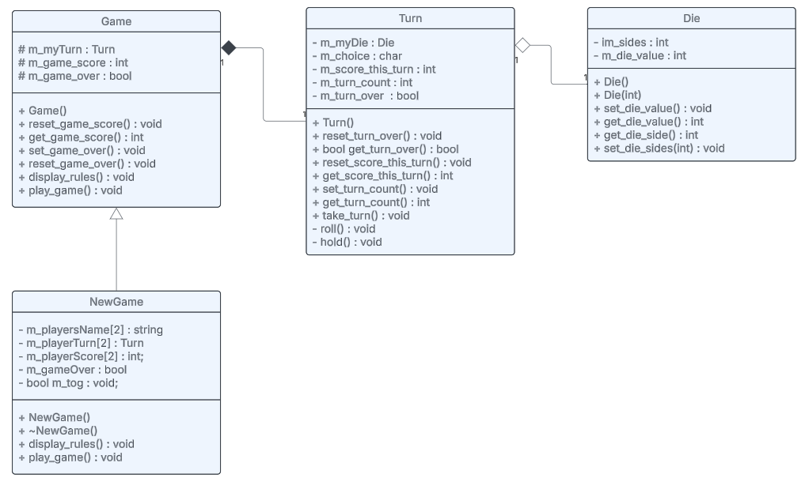

# Pig Dice (Multi-Player) Version

## Background
After creating a solution for the basic Pig Dice game, we now have an object oriented solution. The next version of this game will 
enhance the Pig Dice game so that it supports multiple players where each person compete against one another to see who can reach 50 points 
in the fewest turns. To accomplish this, you will create a <b>PDGameV2</b> class that will be derived from the <b>PDGame</b> class created in the earlier Pig Dice solution. Derived classes like the <b>PDGameV2</b> class significantly improve reusability of a program through the principle of inheritance. 

You are also being asked to recreate documentation of the projects architecture which show how the classes in the program are related. This is 
especially useful when you are modifying existing code or adding new objects to provide more features to the existing code base.

## Directions
Create a derived class named <b>PDGameV2</b>. The <b>PDGameV2</b> class should include string variables for each players full name, each player's score, and reuse through inheritance, the PDGame class defined in the earlier Pig Dice game. 

<b>Note: Your solution must recreate the <i>exact</i> user interface shown below.</b>

## Pig Dice 3.0 UML Diagram 

## Interface Prototype Example

### Test Case Output
<pre><b>Let's Play PIG Dice!

* See which player will reach 50 points in the fewest turns.
* Turn ends when you hold or roll a 1.
* If you roll a 1, you lose all points for the turn.
* If you hold, you save all points for the turn.

How many people are playing? 2
Enter player 1's name: Don Duck
Enter player 2's name: Mick Mouse

Don Duck (Score:0) - TURN 1
roll or hold? (r/h): r
Die: 1
Turn over. No score.
Score for turn:0
Don Duck's total score:0

Mick Mouse (Score:0) - TURN 1
roll or hold? (r/h): r
Die: 1
Turn over. No score.
Score for turn:0
Mick Mouse's total score:0

Don Duck (Score:0) - TURN 2
roll or hold? (r/h): r
Die: 5
roll or hold? (r/h): r
Die: 2
roll or hold? (r/h): r
Die: 5
roll or hold? (r/h): r
Die: 2
roll or hold? (r/h): h
Score for turn:14
Don Duck's total score:14

Mick Mouse (Score:0) - TURN 2
roll or hold? (r/h): r
Die: 4
roll or hold? (r/h): r
Die: 2
roll or hold? (r/h): r
Die: 2
roll or hold? (r/h): r
Die: 6
roll or hold? (r/h): h
Score for turn:14
Mick Mouse's total score:14

Don Duck (Score:14) - TURN 3
roll or hold? (r/h): r
Die: 3
roll or hold? (r/h): r
Die: 4
roll or hold? (r/h): r
Die: 4
roll or hold? (r/h): r
Die: 1
Turn over. No score.
Score for turn:0
Don Duck's total score:14

Mick Mouse (Score:14) - TURN 3
roll or hold? (r/h): r
Die: 3
roll or hold? (r/h): r
Die: 6
roll or hold? (r/h): r
Die: 4
roll or hold? (r/h): r
Die: 1
Turn over. No score.
Score for turn:0
Mick Mouse's total score:14

Don Duck (Score:14) - TURN 4
roll or hold? (r/h): r
Die: 1
Turn over. No score.
Score for turn:0
Don Duck's total score:14

Mick Mouse (Score:14) - TURN 4
roll or hold? (r/h): r
Die: 2
roll or hold? (r/h): r
Die: 2
roll or hold? (r/h): r
Die: 6
roll or hold? (r/h): r
Die: 6
roll or hold? (r/h): r
Die: 6
roll or hold? (r/h): h
Score for turn:22
Mick Mouse's total score:36

Don Duck (Score:14) - TURN 5
roll or hold? (r/h): r
Die: 6
roll or hold? (r/h): r
Die: 3
roll or hold? (r/h): r
Die: 6
roll or hold? (r/h): r
Die: 3
roll or hold? (r/h): r
Die: 1
Turn over. No score.
Score for turn:0
Don Duck's total score:14

Mick Mouse (Score:36) - TURN 5
roll or hold? (r/h): r
Die: 1
Turn over. No score.
Score for turn:0
Mick Mouse's total score:36

Don Duck (Score:14) - TURN 6
roll or hold? (r/h): r
Die: 2
roll or hold? (r/h): r
Die: 5
roll or hold? (r/h): r
Die: 5
roll or hold? (r/h): r
Die: 3
roll or hold? (r/h): r
Die: 6
roll or hold? (r/h): r
Die: 5
roll or hold? (r/h): h
Score for turn:26
Don Duck's total score:40

Mick Mouse (Score:36) - TURN 6
roll or hold? (r/h): r
Die: 2
roll or hold? (r/h): r
Die: 6
roll or hold? (r/h): r
Die: 3
roll or hold? (r/h): r
Die: 4
roll or hold? (r/h): h
Score for turn:15
Mick Mouse's total score:51

Congratulations Mick Mouse you're the winner!
You had a final score of 51 points after 6 turns!

THANKS FOR PLAYING!</b></pre>

